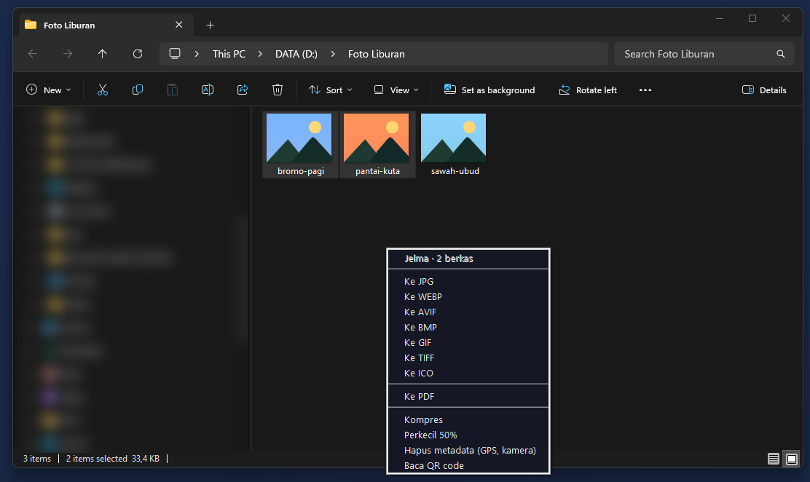
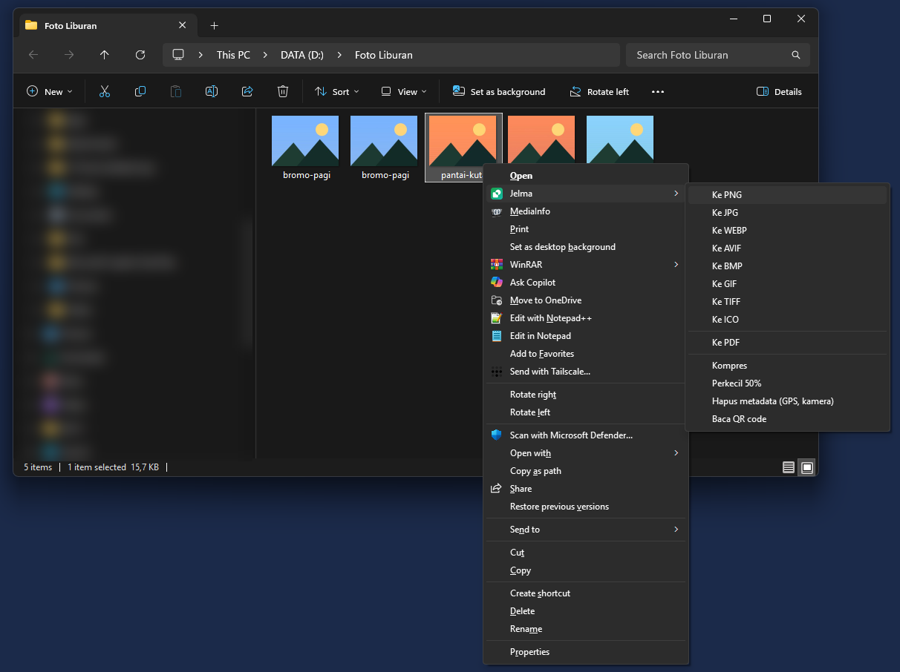
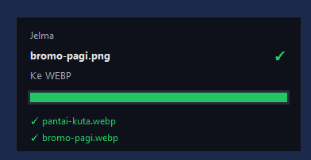

<div align="center">


# Jelma

**Ubah format berkas langsung dari Windows Explorer. Tanpa membuka aplikasi, tanpa internet.**

Pilih berkas → tekan <kbd>Ctrl</kbd> + <kbd>Alt</kbd> + <kbd>J</kbd> → pilih format. Selesai.

[](https://github.com/mhanafi09051998/jelma/releases/latest)
[](https://github.com/mhanafi09051998/jelma/releases)
[](#unduh)
[](LICENSE)

### [⬇ Unduh Jelma untuk Windows](https://github.com/mhanafi09051998/jelma/releases/latest)



</div>

## Kenapa Jelma

- **Tidak perlu membuka apa pun.** Menu format muncul tepat di kursor, di jendela Explorer yang sedang Anda pakai.
- **Berkas Anda tidak ke mana-mana.** Semua diproses di laptop sendiri. Tidak ada unggahan ke situs konverter, tidak ada akun, tidak ada iklan.
- **Berkas asli tidak pernah diubah.** Hasilnya selalu salinan baru di sampingnya: `foto.heic` → `foto.webp`.
- **Banyak berkas sekaligus.** Pilih 50 foto, satu kali tekan, semuanya dikerjakan berurutan dalam satu jendela kecil.

## Yang bisa dilakukan

| Jenis | Masukan | Menjadi / alat |
|---|---|---|
| 🖼️ Gambar | PNG, JPG, WEBP, AVIF, **HEIC (iPhone)**, BMP, GIF, TIFF, ICO | PNG, JPG, WEBP, AVIF, BMP, GIF, TIFF, ICO, PDF · kompres · perkecil 50% · hapus metadata (lokasi GPS, kamera) · baca QR code |
| 🎬 Video | MP4, MKV, WEBM, MOV, AVI, M4V, WMV, FLV | MP4, MKV, WEBM, MOV, GIF · ambil audio MP3 · kompres · hapus metadata |
| 🎵 Audio | MP3, WAV, OGG, FLAC, M4A, AAC, OPUS, WMA | MP3, WAV, OGG, FLAC, M4A, OPUS · hapus metadata |
| 📄 PDF | PDF | Kompres · ke PNG/JPG per halaman · hapus metadata |

Hasil baca QR code langsung disalin ke clipboard, sekaligus disimpan sebagai `.txt`.

## Dua cara memakai

**1. Pintasan keyboard** (paling cepat): pilih berkas di Explorer atau Desktop, tekan <kbd>Ctrl</kbd> + <kbd>Alt</kbd> + <kbd>J</kbd>.

**2. Menu klik kanan**: tahan <kbd>Shift</kbd>, klik kanan berkas, pilih **Jelma**. Menu ini hanya muncul saat Shift ditahan, jadi menu klik kanan biasa Anda tetap bersih.

<div align="center">

<br><br>

<br><sub>Progres tampil di pojok layar. Klik nama hasil untuk membukanya di Explorer.</sub>
</div>

Jelma berjalan diam-diam sebagai ikon kecil di tray (±45 MB RAM). Dari ikon itu Anda bisa menjeda pintasan, mengganti kombinasi tombol, atau mematikan mulai otomatis.

## Unduh

1. Unduh **`Jelma-Setup-x.y.z.exe`** dari [rilis terbaru](https://github.com/mhanafi09051998/jelma/releases/latest).
2. Jalankan. Tidak butuh hak admin, tidak butuh Python.
3. Selesai: Jelma langsung aktif dan ikut menyala setiap Windows mulai.

> **Muncul "Windows protected your PC"?** Installer ini belum ditandatangani (code signing berbayar).
> Klik **More info → Run anyway**. Seluruh kodenya terbuka di repo ini untuk diperiksa siapa saja.

<details>
<summary><b>Pertanyaan umum</b></summary>

**Apakah butuh internet?** Tidak. Setelah terpasang, Jelma tidak pernah mengirim apa pun ke internet.

**Pintasan Ctrl+Alt+J bentrok dengan aplikasi lain.** Klik kanan ikon Jelma di tray → *Ganti pintasan*.

**Cara menghapus Jelma?** Settings → Apps → Installed apps → Jelma → Uninstall. Menu klik kanan dan mulai otomatis ikut terhapus.

**Kenapa ukurannya ±120 MB?** Sebagian besar adalah FFmpeg, mesin konversi video dan audio yang dibawa di dalamnya agar Anda tidak perlu memasang apa pun lagi.

</details>

## Filosofi ikon

Ikon Jelma terinspirasi dari susunan Candi Borobudur: teras **persegi** di bawah (*Rupadhatu*, ranah yang masih
terikat bentuk) naik menuju teras **melingkar** di atas (*Arupadhatu*, ranah tanpa bentuk).

- **Persegi** di kiri-bawah: berkas dalam wujud asalnya. **Lingkaran** di kanan-atas: wujud barunya.
- **Arah naik**: perubahan sebagai pendakian, dibaca kiri ke kanan dan bawah ke atas.
- **Irisan yang dilubangi**: saat *menjelma* ("mewujudkan diri; mengambil bentuk", KBBI), bukan lagi persegi dan belum lingkaran.
- **Putih utuh**: berkas asli tidak pernah dirusak; yang berubah hanya wujudnya.

## Untuk pengembang

Butuh Python 3.12 dan [Inno Setup 6](https://jrsoftware.org/isinfo.php).

```powershell
pip install -r requirements.txt
powershell -ExecutionPolicy Bypass -File build.ps1
```

`build.ps1` mengunduh FFmpeg (build GPL BtbN, diverifikasi SHA256) ke `vendor/`, menjalankan tes, membekukan
aplikasi dengan PyInstaller, lalu membuat `dist\Jelma-Setup-<versi>.exe`. Mode pengembangan tanpa build:
`python masuk.py --latar`, atau `python masuk.py gambar-ke-webp foto.png`.

Semua aksi didaftarkan di satu tempat, [`jelma/daftar_aksi.py`](jelma/daftar_aksi.py): menambah format baru cukup
satu baris di sana, lalu menu klik kanan, menu pintasan, dan CLI ikut bertambah. Kontribusi dipersilakan.

## Lisensi

Kode Jelma berlisensi [MIT](LICENSE). Komponen pihak ketiga, termasuk FFmpeg (GPL v3, dijalankan sebagai
program terpisah), tercantum di [PIHAK-KETIGA.txt](PIHAK-KETIGA.txt).

<div align="center"><sub>Dibuat di Mojokerto oleh <a href="https://muhammadhanafi.web.id">Muhammad Hanafi</a></sub></div>
